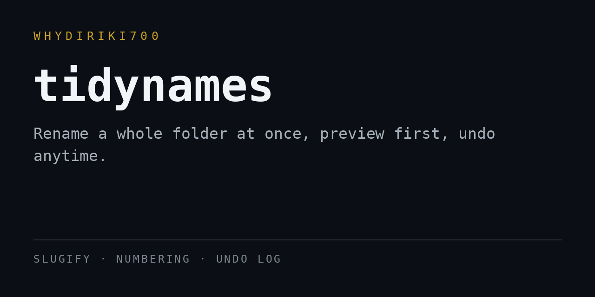

# tidynames

Renaming 300 photos one by one is misery. tidynames renames a whole folder
at once, shows you the full plan before anything changes, and keeps an undo
log so the whole batch can be rolled back.

## Patterns

- `--slugify`: lowercase names, spaces become dashes, unsafe characters go
  away (`Foto Liburan 2026!.JPG` becomes `foto-liburan-2026.jpg`)
- `--number`: prefix a sequence, `001-`, `002-`, with `--start` to begin
  anywhere
- `--date-prefix`: prefix the file date as `YYYYMMDD-`
- `--prefix TEXT`: put your own text in front of every name
- `--replace FROM TO`: swap one piece of text for another

Patterns combine: `--date-prefix --number --slugify` gives you
`20261121-001-foto-liburan.jpg` style order for a whole folder.

## Safety

- Default is a dry run. Nothing is renamed until you add `--apply`.
- Name clashes are reported and skipped, never forced or overwritten.
- Every applied batch writes a tidynames-undo.json log in the folder.
  `python -m tidynames FOLDER --undo` restores every original name.

## Usage

```
python -m tidynames ~/Pictures/liburan --slugify --number
python -m tidynames ~/Pictures/liburan --slugify --number --apply
python -m tidynames ~/Pictures/liburan --undo
```

## Tests

```
python -m unittest discover -s tests
```

Zero dependencies. Python 3.9+. MIT license.
